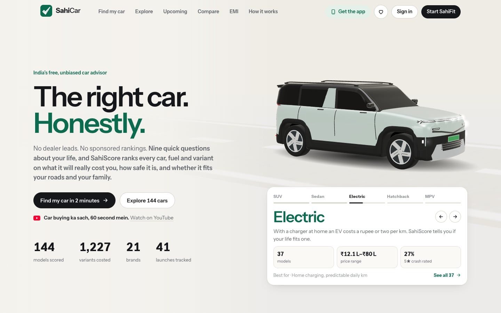
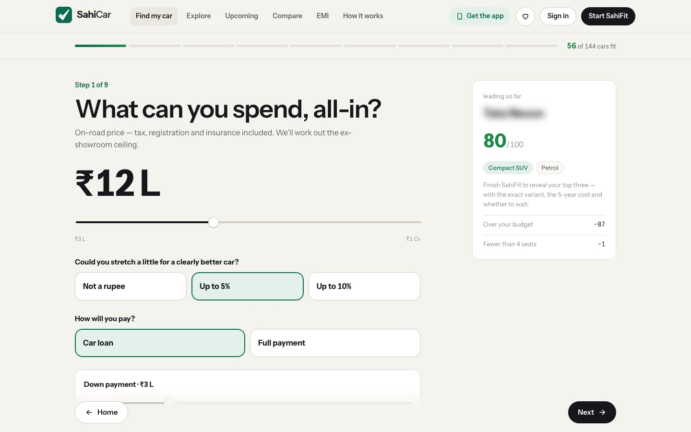
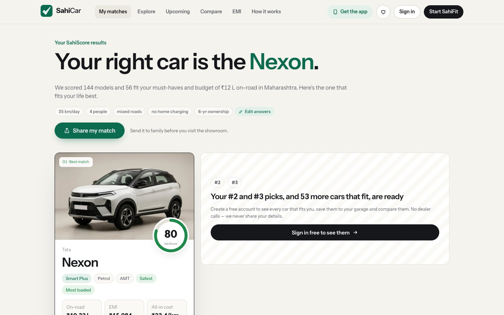
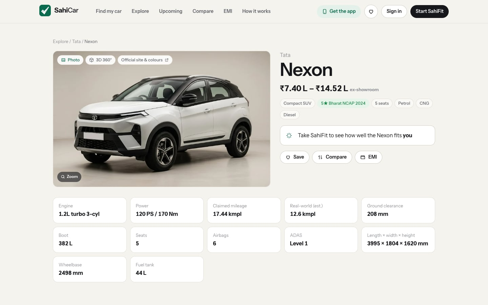
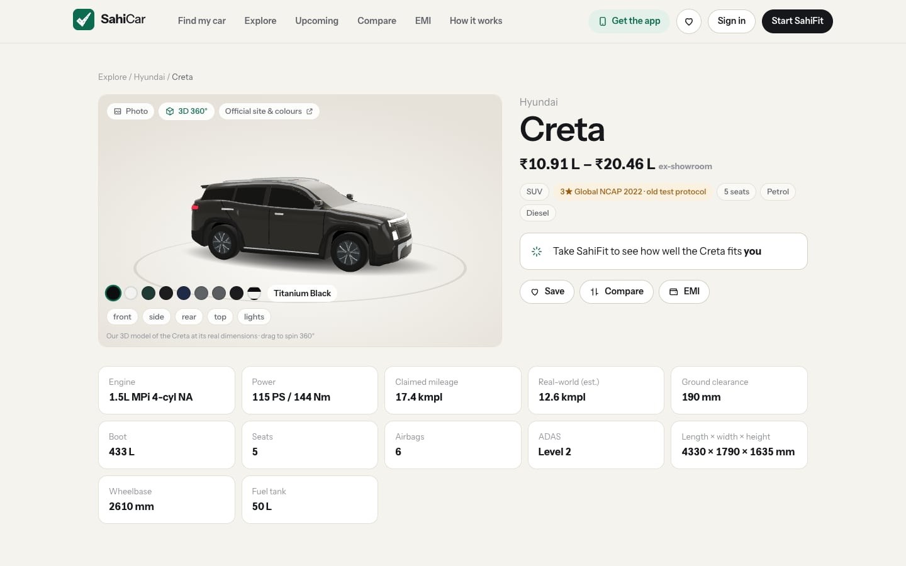
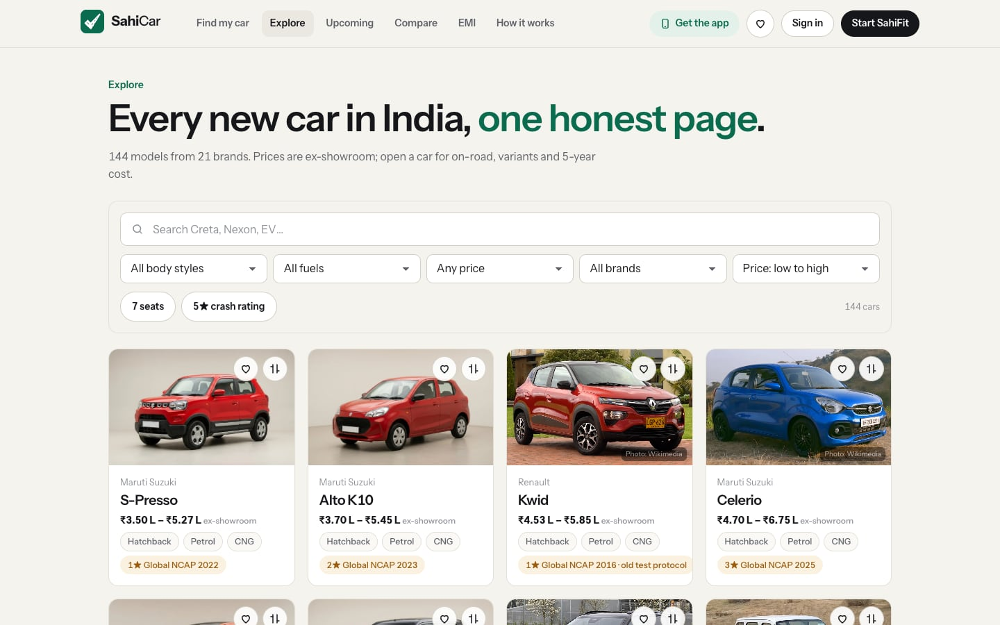
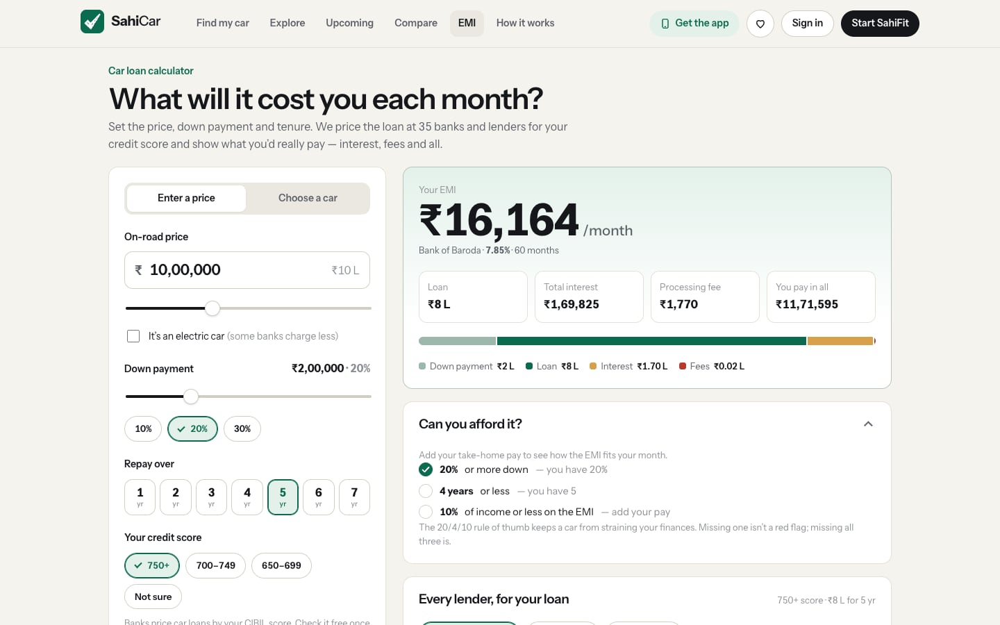
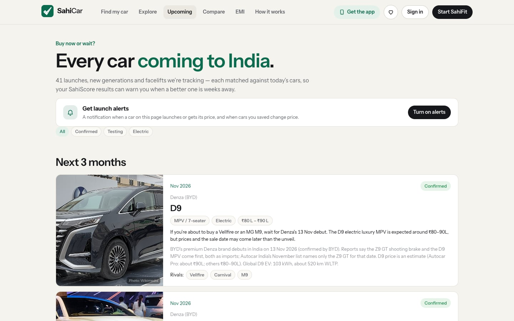
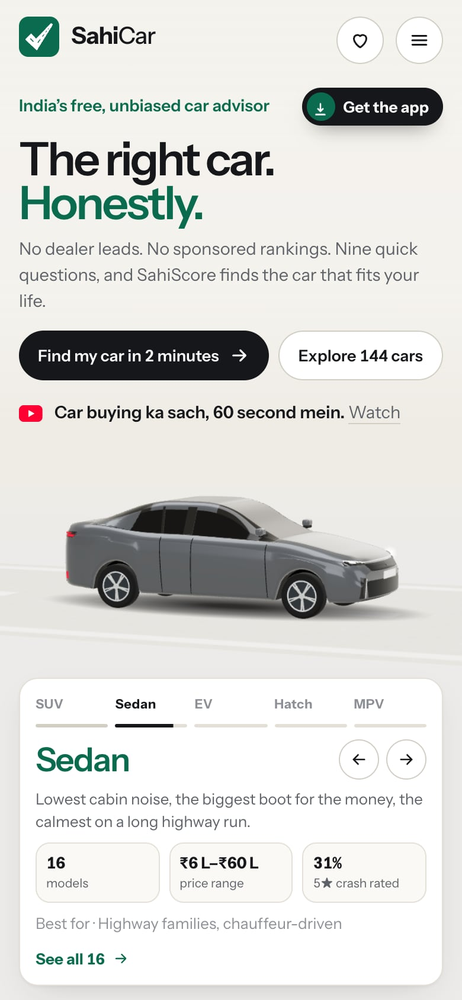

# SahiCar

**The right car, honestly.** SahiCar is a free, unbiased car advisor for India.
- **SahiFit:** a 2-minute quiz about your budget, family, roads and use.
- **SahiScore:** the engine that ranks every car, fuel, gearbox and variant on its 5-year cost, safety and fit for your life.
- **Buy now or wait:** it tells you whether a launch is worth waiting for.

There are no dealer leads, no sponsored rankings and no selling your number.

**Live:** [sahicar-in.web.app](https://sahicar-in.web.app) · **YouTube:** [@SahiCar](https://www.youtube.com/@SahiCar) · **Instagram:** [@sahicar.official](https://www.instagram.com/sahicar.official/)



| SahiFit quiz | Your SahiScore results |
| --- | --- |
|  |  |
| **A car, scored for you** | **Its photo-measured 3D model** |
|  |  |
| **Every new car, one honest page** | **What it will cost you each month** |
|  |  |
| **Every car coming to India** | **On a phone** |
|  |  |

The strategy, competitor research, the algorithm in full and the roadmap are in [docs/STRATEGY.md](docs/STRATEGY.md).

## What's in it

| | |
|---|---|
| **144 new cars, 21 brands** | Ex-showroom prices for every variant, on-road estimates by state, 5-year running cost, Bharat NCAP / Global NCAP ratings, a best-value variant pick and a plain-words verdict. Verified November 2026. |
| **SahiFit + SahiScore** | 9 questions, 11 sub-scores, your top 3 (and the rest), shareable results, and "buy now or wait" timing against 41 tracked launches. |
| **65 photo-measured 3D models** | A 360° studio on the car page with real paint colours, lights and views. Each model is traced from photos and calibrated to official dimensions (method below). Every other car shows its body style at its real size. |
| **Photos and galleries** | Wikimedia Commons photos (credited), plus AI-generated studio renders for 76 cars and gallery shots for some. |
| **Explore, Compare, Upcoming** | Filter by budget, body, fuel, brand, 7 seats and 5-star rating. Compare up to 3 cars. See launches due in the next 3 months. |
| **EMI calculator** | EMI, down payment and total interest for any car, rates across lenders, and an "can you afford it?" check. |
| **App, no store needed** | Installs from the browser on Android and iPhone, opens full-screen and works on a weak signal or offline. |
| **Garage and price alerts** | Save cars (synced when signed in). Push alerts arrive when a saved car's price changes or a tracked car launches. |
| **Weekly auto-update** | Every Monday a GitHub Action researches launches and price changes and opens a pull request. Nothing goes live until it is merged. See [docs/weekly-update.md](docs/weekly-update.md). |

## Run it

```bash
npm install
npm run dev            # http://localhost:5173
```

Everything works without Firebase: sign-in is hidden and the garage is kept in the browser.

## Data

```
research/cars-*.json        researched car data (see research/SCHEMA.md)
research/upcoming.json      upcoming launches         research/timing-events.json  dates that move prices
research/onroad.json        state road tax, fuel prices, insurance %
research/images.json        Wikimedia photo cache     research/ai-renders/         studio renders and galleries
        │
        └─ npm run data  →  src/data/*.json   (validates, normalises brands/fuels, drops bad rows; runs on every build)
```

- `npm run images` finds free Wikimedia Commons photos for new cars. Run `npm run data` afterwards.
- `npm run ai-renders` adds studio renders and gallery shots from `research/ai-renders/` (watermark removed, cropped to 16:10) to `public/cars/`.
- `npm run test:engine` runs SahiScore for seven typical Indian buyers and prints their top 3. Use it to check behaviour after changing data or weights.
- `npm run weekly` runs the weekly update locally. The scheduled version runs on GitHub Actions.

To update prices by hand, edit the research JSON and rebuild. Keep `verifiedOn` and `sources` honest.

## 3D cars

Each modelled car is a procedural, lofted body built from a `CarSpec` in `src/webgl/cars/exact.ts`. There are no downloaded models, no logos and blank number plates. The method is in [scripts/trace/PLAYBOOK.md](scripts/trace/PLAYBOOK.md):

1. **Measure the side:** cut the car out of a side photo and trace its silhouette (`scripts/trace/extract-side.cjs`).
2. **Write the spec:** official dimensions and tyres, with the shape from the photo.
3. **Score it:** `scripts/trace/compare-side.cjs` measures the overlap (IoU) with the photo. The target is ≥ 0.94 overall and ≥ 0.90 for the upper half.
4. **Check details:** `scripts/trace/ncmp.cjs` compares lamps, colour and wheels against photos.
5. **Ship:** add the id to `READY` in `src/webgl/cars/specs.ts`, then run `node scripts/posters.cjs <id>`. That makes the small loading poster shown while the 3D builds.

## Search (SEO)

- **Pre-rendering:** `npm run build` ends with `scripts/prerender.mjs`. It opens every sitemap page in headless Chrome and saves the finished page as static HTML (`dist/car/<id>.html` and so on). Search engines and slow phones get the real content first, and the app then takes over without a flash (`src/main.tsx`).
- **Meta per page:** each page sets its own title, description, canonical address, Open Graph tags and JSON-LD (Car, BreadcrumbList, Organization) through `src/lib/seo.ts`.
- **Real 404s:** unknown addresses return status 404. App-only pages (garage, results, login) are served the plain shell and are blocked in robots.txt.
- **Sitemap:** `public/sitemap.xml` is rebuilt on every build, with each car's last-verified date.
- **IndexNow:** after each deploy, `scripts/indexnow.mjs` notifies Bing and the other IndexNow engines of every page. The key file is `public/<key>.txt`.

## Deploy

Pushing to `main` runs `.github/workflows/deploy.yml`:
1. **Build:** data, sitemap, type check, Vite build and pre-render. A broken build never goes live.
2. **Deploy** to Firebase Hosting.
3. **Notify IndexNow.**
4. **Send push alerts** for price changes and launches, when the car data changed.

Other workflows:
- `weekly-update.yml`: the Monday research pull request.
- `push-alert.yml`: send one alert by hand.
- `weekly-test-email.yml`: preview the report email.

## Firebase (free Spark plan)

1. Create a project at console.firebase.google.com (Spark plan) and add a Web app.
2. In Authentication, enable **Google** and **Email/Password** sign-in, and add your domain to the authorised domains.
3. Create a **Firestore** database in production mode.
4. Copy `.env.example` to `.env.local` and fill in `VITE_FIREBASE_*`.
5. Put your project id in `.firebaserc`, then run:

```bash
npx firebase login
npm run deploy         # builds (with pre-render), then deploys hosting + firestore rules
```

To develop against the local emulators, set `VITE_FIREBASE_EMULATORS=1` and `VITE_FIREBASE_PROJECT_ID=demo-sahicar` in `.env.development.local`, then run `npm run emulators`.

Firestore holds only `users/{uid}` (name, email, SahiFit answers), `users/{uid}/garage/{carId}` and push subscriptions. Only the owner can read or write their data; see [firestore.rules](firestore.rules).

## Code map

| Path | What |
|---|---|
| `src/engine/sahiscore.ts` | The recommendation engine: configurations, filters, 11 sub-scores, weights, penalties, top 3 |
| `src/engine/costs.ts` | On-road price, real-world efficiency, EMI, resale, 5-year total cost |
| `src/engine/timing.ts` | Buy now / consider waiting / wait |
| `src/engine/answers.ts` | The SahiFit questions' shape and defaults |
| `src/webgl/cars/exact.ts` | The photo-measured `CarSpec`s (65 live) |
| `src/webgl/cars/specs.ts` | Showcase likenesses, the `READY` list and `SPEC_BY_ID` |
| `src/webgl/cars/build.ts`, `loft.ts` | Turn a spec into a car: lofted body, creases, pillars, cladding, lamps and grille projected onto the body, wheels, blank plates |
| `src/webgl/Studio.ts`, `env.ts` | The 3D 360° studio on car pages (low detail first, full detail when idle), and procedural lighting |
| `src/webgl/HeroWorld.ts` | The landing hero: five body styles cycling, adaptive quality, stops when scrolled away |
| `src/lib/seo.ts` | Per-page title, description, canonical, Open Graph and JSON-LD |
| `src/lib/push.ts`, `public/sw.js` | Push alerts and the service worker (offline, instant repeat visits) |
| `scripts/prerender.mjs`, `scripts/indexnow.mjs` | Static HTML per page at build time; IndexNow after deploy |
| `scripts/weekly-update.mjs` | The Monday research and pull request |
| `scripts/trace/*`, `scripts/posters.cjs` | 3D tracing, scoring, review sheets and loading posters |
| `src/pages/*` | Landing, Wizard, Results, CarDetail, Explore, Compare, Upcoming, Emi, Garage, Login, About, HowWeScore, AppPage |
| `src/fb/*`, `src/state/*` | Firebase (lazy-loaded), auth, persisted app state |

## Performance and reliability

- **Instant first paint:** every public page is pre-rendered, so the real content shows before any JavaScript runs. On slow 4G, a car page's main content appears in about 1.4 s.
- **Small first download:** three.js and the car database load only with the pages that need them.
- **3D:**
  - It starts after first paint, from a ~20 KB poster, at low detail first, with full detail once the browser is idle.
  - It's skipped on Save-Data or 2G connections and when WebGL is missing.
  - It loads no models, textures or HDRs: everything is procedural.
- **Adaptive quality:** resolution follows the frame rate. Rendering pauses in background tabs, and a lost WebGL context falls back to the poster.
- **Service worker:** repeat visits are instant and work offline.
- **Overrides:** `?perf=low` and `?3d=0` force the low tier or no 3D, for testing.

## Disclaimer

- **Prices** are ex-showroom Delhi, verified November 2026. On-road figures are estimates; confirm with the dealer before paying.
- **Crash ratings** come from Bharat NCAP and Global NCAP.
- **Photos** are from Wikimedia Commons under their licences, or the manufacturer's own, credited. Studio renders (shown without a photo credit) are AI-generated illustrations.
- **3D models** are SahiCar's own procedural models, measured from photos. They carry no logos and blank number plates.
- **The landing page's five body-style cars** are unnamed likenesses.
